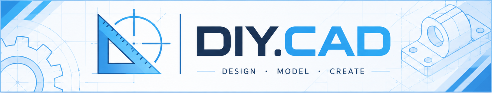
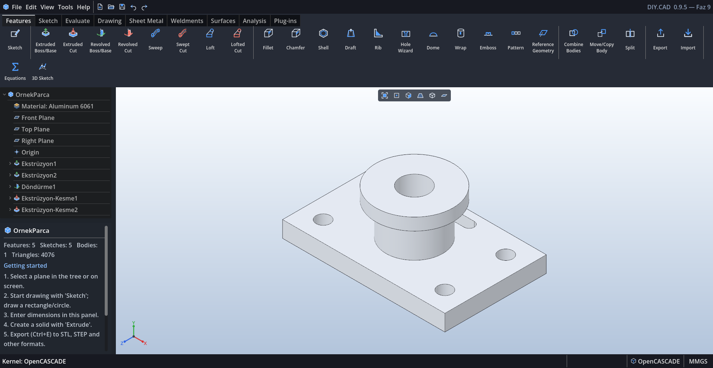
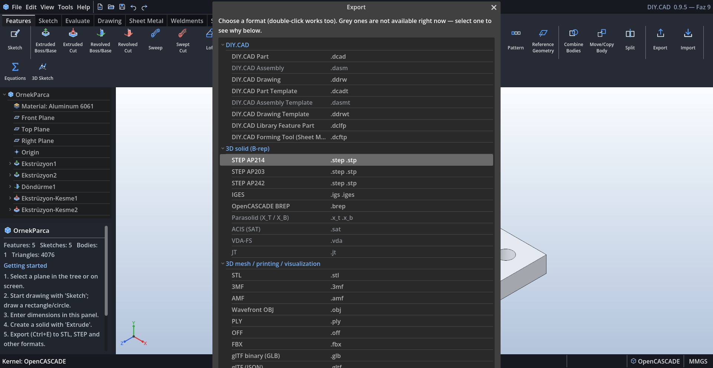
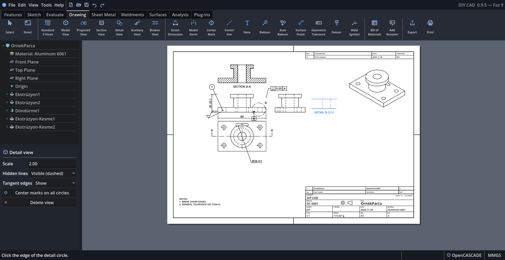
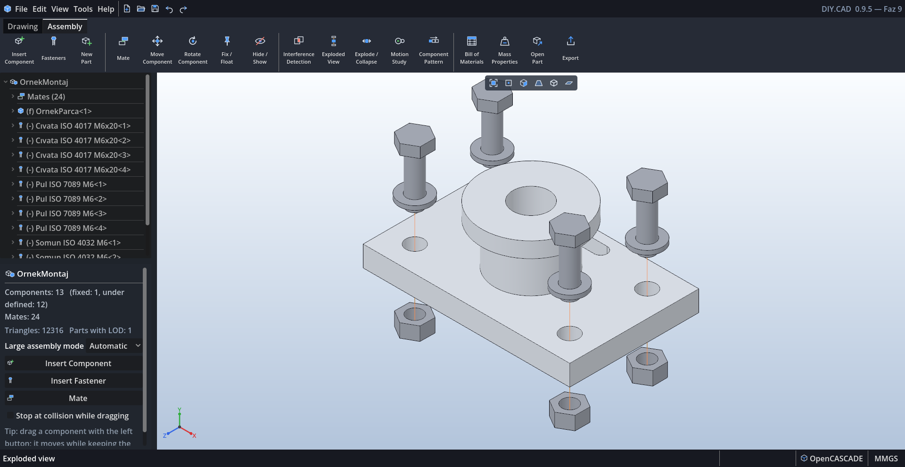
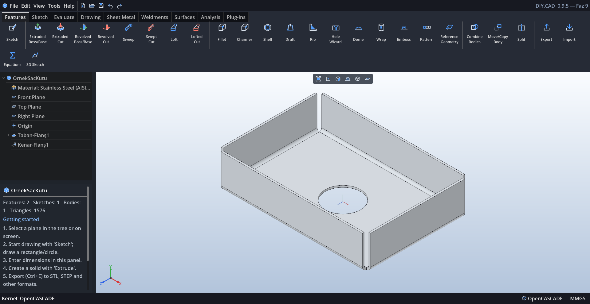
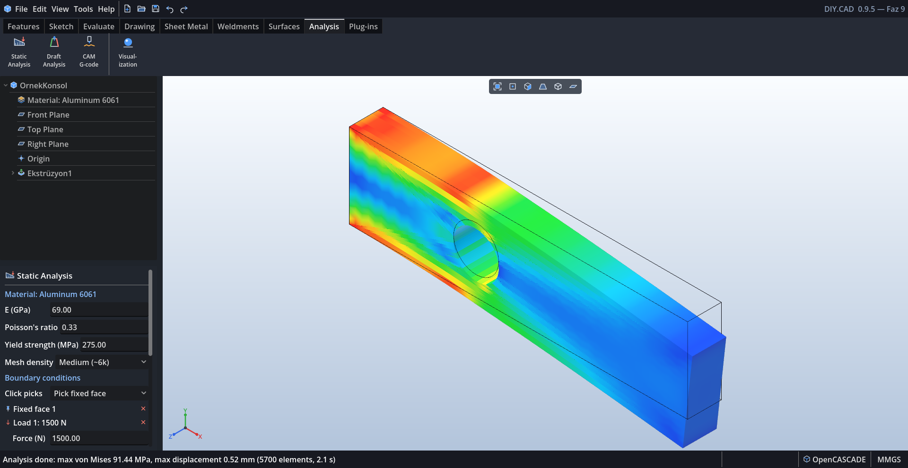
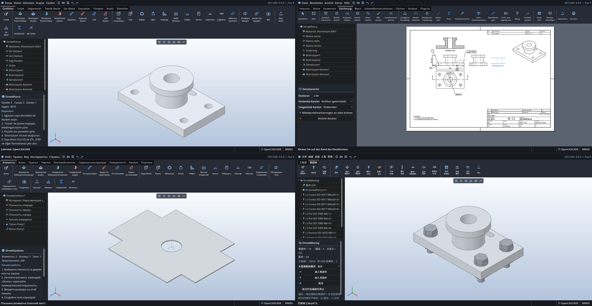

<p align="center"></p>

# DIY.CAD

**English** | [Türkçe](README.tr.md)

A **parametric, feature-based** CAD program written in Godot 4.7.
Goals and phases: [ROADMAP.md](ROADMAP.md)

**Current version: 0.9.5 — new logo, complete Turkish / English / German / Russian / Chinese UI, one Export dialog for 40+ formats, STL import (per-axis scale, regional stretch, tapered growth, protected region) + Phase 9 (complete): background mesh processing, LOD for large assemblies, plugins, Windows packaging, auto-save, keyboard shortcuts, mouse gestures, macros** (previous: Phase 8). Release notes: [CHANGELOG.md](CHANGELOG.md)

The user interface is Turkish by default; switch to English, German, Russian or Chinese under **Tools → Options → General → Language** (applies instantly) or start with `--lang=en` (`de`, `ru`, `zh`). Menu and tool names below are given as they appear in the English UI.



## Download (Windows, no Godot needed)

Get the latest version from the **[Releases](https://github.com/emirrdumann729-ui/DIY.CAD/releases/latest)** page:

| File | What it is |
|---|---|
| `DIY.CAD-<version>-setup.exe` | Installer (recommended): per-user install, no admin rights, Start menu / desktop shortcut, `.dcad` / `.dasm` file association, optional OpenCASCADE setup |
| `DIY.CAD-<version>-portable.zip` | Portable: unzip anywhere and run `DIY.CAD.exe` |

The program runs right away with the built-in CSG kernel (sketches, extrude / revolve / cut, STL export...). Features that need the OpenCASCADE kernel (fillet, shell, STEP, drawings, sheet metal...) require Python 3.11–3.13: tick "Install the OpenCASCADE kernel" in the installer, or run `OCC_Kur.bat` once. The executables are not code-signed, so Windows SmartScreen may warn on first launch ("More info → Run anyway").

Godot is only needed to run from source or to change the code (see below).

## Screenshots

| | |
|---|---|
|  |  |
| **Export** — every format in one dialog (Ctrl+E); unavailable ones show the reason | **Drawing** — standard views, section, detail, dimensions, annotations, title block |
|  |  |
| **Assembly** — mates, standard fasteners, exploded view | **Sheet metal** — base / edge flanges, flat pattern |
|  |  |
| **Static analysis** — von Mises stress map | **Five UI languages** — Turkish, German, Russian, Chinese and English |

## Running from source

| File | What it does |
|---|---|
| `DIY.CAD.bat` | Starts the program |
| `Editor.bat` | Opens the project in the Godot editor (to change the code) |
| `Test.bat` | Runs the automated tests (unit, constraint solver, sketch operations, end-to-end UI; B-rep tests too when OCC is installed) |
| `OCC_Kur.bat` | Installs the OpenCASCADE (B-rep) kernel (once) |
| `Paketle.bat` | Windows package: `build\DIY.CAD.exe` (portable) and, if Inno Setup 6 is installed, `build\installer\DIY.CAD-<version>-setup.exe`. Requires the Godot 4.7.1 export templates (editor: Editor → Manage Export Templates) |

Godot is expected at `Godot\Godot_v4.7.1-stable_win64.exe` in the parent folder.

Command-line options (after `--`):
- `--demo` opens with a sample part, `--demo2` with the name-plate sample
- `--open=path\part.dcad` opens a file
- `--uitest` runs the end-to-end UI test
- `--kernel=auto|occ|csg` selects the geometry kernel (overrides the saved setting)
- `--macro=file.gd` runs a macro at startup; `--lang=en|tr` and `--theme=light|dark` override the setting for that session; `--no-plugins` skips loading plugins
- A `.dcad` / `.dasm` path given on the command line (file association) is opened

## Make your first part

1. Click **Top Plane** in the tree on the left and press **Sketch** at the top.
2. Draw a rectangle with **Corner Rectangle** (R) using two clicks. The edges get horizontal/vertical relations automatically.
3. **Smart Dimension** (D): click the top edge, place it above, type `60` in the box, Enter. `40` for the left edge.
4. If the sketch is still **blue** it is under-defined: dimension a corner to the origin, or draw a diagonal centerline
   and select it together with the origin to add a **Midpoint** relation. When everything is **black** the status bar says *Fully Defined*.
5. Draw a **Circle** (C) and give its diameter with Smart Dimension.
6. Press **Extrude**, enter the depth, **OK**.
7. Pick a material with **Evaluate → Material** and see the weight with **Mass Properties**.
8. Get a 3D-printable file with **File → Export... (Ctrl+E) → STL**.

Click a face and press **Sketch** again to draw on that face (to add a boss or a cut).

## Sketch tips

- **Colors:** blue = under-defined, black = fully defined, red = over-defined.
- **Changing a dimension:** double-click its label. The sketch updates itself while keeping all relations.
- **Adding relations:** select entities with Shift/Ctrl; the panel on the left lists the applicable relations (parallel, perpendicular, tangent, equal...).
- **Deleting relations:** click the green icon and press Delete, or delete it from the "Existing relations" list in the panel.
- **Conflicts:** an impossible dimension or relation is undone automatically and a warning appears in the status bar.
  An extra (redundant) dimension becomes a driven (reference, in parentheses) dimension.

## Phase 3 tools

| Tool | Usage |
|---|---|
| Trim (T) | Click the piece to delete; the part between the nearest intersections is removed |
| Extend (E) | Click near the end of a line; it extends to the first entity it meets |
| Sketch Fillet / Chamfer | Pick the tool, set the radius in the panel, click the corner |
| Offset | Select entities → Offset → distance + direction → OK (with preview) |
| Mirror | Select entities together with a centerline → Mirror |
| Move / Pattern | Select entities → move, rotate, scale, linear or circular pattern |
| Polygon (P), Slot, Spline, Text | From the sketch toolbar; text content and size in the panel |
| Ellipse | Center → major axis end → minor axis width; semi-axes are dimensioned with Smart Dimension |
| Parabola | Vertex → focus → start end → end point; joining the ends with a line gives a closed contour |
| Convert Entities | While sketching, click a model face; its edges come into the sketch as fixed lines/arcs |
| Block | Select entities → Block: they become a rigid unit (drag to move/rotate together); explode or copy from the panel |
| Select regions | "Select regions" in the extrude/revolve panel → click the areas formed by intersecting curves |
| 3D Sketch | Features → 3D Sketch: click points, switch the drawing plane (XY/XZ/YZ) with **Tab**; drawing near an axis locks to X/Y/Z |

**Equations:** add global variables in the Features → Equations panel (e.g. `width = 100`).
Type `=width/2` in a dimension's value box; the dimension is marked with Σ and everything updates when the variable changes.
Other dimensions can be referenced as `"D1@Sketch1" * 2`; an extrude depth can also be `=thickness`.
See **File → Sample: name plate** for an example.

## Phase 4: OpenCASCADE (B-rep) kernel

For true face/edge topology the program starts an OpenCASCADE server (`occ/occ_server.py`) in the background,
running in a project-local Python environment. Setup (once, ~240 MB):

1. Python 3.11–3.13 must be installed (`python --version`).
2. Run `OCC_Kur.bat` (creates the `occ_env` folder and installs `cadquery-ocp-novtk` plus `numpy` + `scipy` for static analysis; re-run it once on older installs).

Without it the program falls back to the CSG kernel automatically. Choose Auto / OpenCASCADE / CSG with the kernel button at the
bottom right or **Tools → Geometry kernel**; STL quality is set there as well.

| Command | Usage |
|---|---|
| Fillet | Click edges (clicking a face adds all its edges, clicking again removes them), enter the radius; "Variable radius" for start/end radii |
| Chamfer | Same selection; equal distance, two distances or angle-distance |
| Shell | Click the faces to leave open, enter the thickness (no face selected = hollow closed body) |
| Draft | Pick the planar neutral face with "Select neutral face", then click the faces to draft; enter the angle |
| Rib | Draw an open line in a sketch (it need not touch the body, the ends are extended) → Rib → thickness |
| Merge result | When unchecked in the extrude/revolve panel a new body is created |
| Combine Bodies | Click bodies (the first is the main body), choose the operation: add / subtract / common |
| Move/Copy Body | Click a body, enter ΔX/ΔY/ΔZ and the rotation axis/angle; "Copy" keeps the original |
| Split | Pick a main plane + offset; both sides become separate bodies or only one side is kept |
| Export (Ctrl+E) | One dialog for every format (File → Export... or the Export button): DIY.CAD part / assembly / drawing / templates, STEP AP203 / AP214 / AP242, IGES, BREP, STL, 3MF, AMF, OBJ, PLY, OFF, FBX, glTF / GLB, VRML, XAML, IFC, HTML 3D viewer, sketch DXF / SVG, drawing PDF / DXF / SVG / AI, PNG / JPEG / BMP / TIFF / PSD, XML report, ZIP package. Formats that cannot be written (Parasolid, ACIS, JT, DWG...) are greyed out with the reason and a recommended alternative |
| Import | Adds a STEP/IGES file as a body; you can sketch on it and cut/extrude |

While selecting, the model is shown as it was before the edited feature; the "Preview result" box shows the result.
Mass properties and measured volumes are computed exactly from the B-rep.

**Topological naming:** faces get persistent names from the feature and sketch entity that created them; the edges/faces you
select are stored by these names. Even when the part's dimensions change a lot, a fillet stays on the right edge and a sketch
drawn on a face moves with its support face (e.g. when the base gets taller, the boss on top moves to the new top face).

## Phase 5 tools

| Tool | Usage |
|---|---|
| Reference Geometry ▾ | Plane (offset / angled / 3 points / tangent to face), Axis, Point, Coordinate System, Helix / Spiral (can be tapered), Projected Curve. Click a plane's edge and use "Sketch" to draw on it |
| Extrude end conditions | Up To Next, Up To Vertex, Up To Surface, Offset From Surface (click the model with "Select target face"); Two directions, Draft angle, Thin feature |
| Sweep / Swept Cut | Profile sketch + path (sketch chain, 3D sketch, helix or projected curve); optional guide curve or twist angle |
| Loft / Lofted Cut | Tick the sketches with closed profiles; optional guide curve |
| Pattern ▾ | Linear (2 directions), Circular, Mirror, Table, Curve-driven; the feature selected in the tree is added automatically, direction/axis can be picked on the model |
| Wrap | Draw a sketch (e.g. text) on a plane tangent to a cylinder → Wrap → pick the cylindrical face → emboss / deboss / scribe |
| Emboss | Raise or engrave the sketch profile onto the body surface (may be curved) at constant thickness |
| Mass properties | Results can be reported relative to a coordinate system if one exists |
| Hole Wizard | Pick the standard (ISO/ANSI), type, size and fit; each click on a planar face places a hole |
| Dome | Click a planar face, enter the height |
| Rollback bar | Drag it in the tree, or right-click a feature → "Move rollback bar below this" |
| Reordering | Drag and drop a feature in the tree, or right-click → Move up/down; right-click → Parent / Child |

## Phase 6: Drawings

Switching to the **Drawing** tab creates an A3 sheet (ISO, first angle) for the part with the standard 3 views and
an isometric view automatically; the drawing is saved together with the part file. Views are computed with
OpenCASCADE's hidden-line removal (HLR) and update automatically when the model changes.

| Tool | Usage |
|---|---|
| Select | Click a view / annotation → its properties in the left panel (scale, hidden lines, tangent edges, tolerance...). Drag to move; projected views stay aligned |
| Sheet | Size (A4–A0, ANSI A–E), portrait/landscape, ISO/ANSI, first/third angle, sheet scale, title block fields, new sheet |
| Standard 3 Views / Model View | Front-top-side-isometric; or pick an orientation in the panel and click the sheet |
| Projected View | Select a view → click to its right/left/top/bottom |
| Section View | Select a view → click both ends of the section line (hatched A-A view; flip the viewing direction in the panel) |
| Detail View | Select a view → click the center, then the circle edge (magnification in the panel) |
| Auxiliary / Broken View | Click an edge (view perpendicular to it) / click the two limits of the region to remove |
| Smart Dimension | Two vertices (horizontal/vertical/aligned depending on placement), circle (diameter), edge (length), two edges (angle); tolerances in the panel |
| Model Items | Brings sketch dimensions into views parallel to the sketch plane, associatively |
| Center Mark / Centerline, Note, Balloon | Click a circle / two points / a location / target + balloon position |
| Surface Finish, Geometric Tolerance, Datum, Weld Symbol | Place the symbol (target point first if needed), edit values in the panel |
| Bill of Materials, Add Revision | Toggle the BOM table, add a row to the revision table |
| PDF / SVG / DXF / Print | Vector output; a font is embedded in PDFs for Turkish characters. For DWG, convert the DXF with AutoCAD or the free ODA File Converter |

On the canvas the wheel zooms, right/middle button pans, **F** fits the sheet, **Delete** deletes the selection, **Esc** releases the tool.

## Phase 7: Assemblies

**File → New Assembly** (or *Open sample assembly*) switches to assembly mode; the assembly is saved to a `.dasm` file
that references part files by relative path. Only the **Assembly** tab is shown at the top.

| Tool | Usage |
|---|---|
| Insert Component | Pick a part file (.dcad); the first component is fixed (f), the next ones are placed next to it |
| Fasteners | Bolt (ISO 4017), nut (ISO 4032), washer (ISO 7089), pin, bearing — choose size and length and insert |
| Mate | Click faces / edges (a component's main planes can also be picked in the tree) → choose the type; ★ marks suggestions. Standard: coincident, parallel, perpendicular, tangent, concentric, distance, angle, lock. Advanced: width, symmetric, distance/angle limit, slot. Mechanical: hinge, gear, rack and pinion, screw |
| Dragging | Drag a component with the left button: it moves while respecting the mates. Numeric input in the Move / Rotate tools |
| Fix / Float, Hide / Show | For the selected component; in the tree (-) means under-defined, ⚠ an unsatisfied mate |
| Interference Detection | Overlapping volumes are shown in red and listed with their volumes (OpenCASCADE) |
| Exploded View, Explode / Collapse | Add steps (component + direction + distance) or explode automatically; animated toggle |
| Motion Study | Click the cylindrical face of the component to rotate, enter rpm and duration → Play; gear/screw mates transfer the motion |
| Bill of Materials, Mass Properties | Quantity / material / mass table (CSV), total mass and center of gravity |
| Open Part | Edit the component's part; clicking the **Assembly** tab saves the part and returns to the assembly |
| STEP Export | Export the whole assembly as a single STEP file |
| New Part | New part in context: other components are semi-transparent, click their planar faces to start a sketch; use the Assembly tab when done |
| Component Pattern | Click components → linear (direction + spacing) or circular (axis + total angle); instances follow the seed |
| Sub-assembly | Pick a `.dasm` with Insert Component: it is added as a rigid group; sub-assemblies can be expanded in the BOM |
| Cam (mechanical mate) | 1: follower (cylinder / point), 2: the cam's side face — the profile is extracted automatically |
| Stop at collision | Tick in the assembly panel or the Move tool: the dragged component stops before colliding (OpenCASCADE) |
| Drawing (in assembly) | Assembly drawing: views, bill of materials table, **Auto Balloon** |

## Phase 8: Sheet metal, weldments, configurations

| Tool (tab) | Usage |
|---|---|
| Base Flange (Sheet Metal) | Closed-profile sketch → sheet plate; open line chain → bent sheet (L, U, Z...). Thickness, bend radius, K-factor in the panel |
| Edge Flange (Sheet Metal) | Click the top or bottom edges of the base plate (several allowed); length, angle, radius, direction and end gaps |
| Flat Pattern / Flat Pattern DXF | Toggle the flat sheet view; save the flat pattern to DXF with bend lines and "UP 90° R2" notes (laser, press brake) |
| Structural Member (Weldments) | Sketch or 3D-sketch lines + profile (square/rectangular tube, pipe, angle, UPN, IPE, flat bar); corner treatment miter or butt; T-joints are trimmed automatically |
| Cut List (Weldments) | Profile, length, cut angles, quantity and mass table; CSV |
| Configuration (Evaluate) | Configurations made of dimension / depth values and suppression states; design table CSV import / export (`D1@Taslak1`, `D1@Ekstrüzyon1`, `$BASTIR@Özellik` — keys use the Turkish feature names) |

### Phase 8 (continued): surfaces, analysis, CAM, visualization

| Tool (tab) | Usage |
|---|---|
| Extruded / Revolved / Loft Surface (Surfaces) | Zero-thickness surface from open or closed sketch curves; the first centerline is the revolve axis; loft joins the last two sketches |
| Planar Surface (Surfaces) | Flat surface from a closed-contour sketch (inner contours become holes) |
| Offset Surface / Knit Surface (Surfaces) | Offset a surface; knit surfaces with coincident edges — converted to a solid if closed |
| Thicken / Trim Surface (Surfaces) | Solid with thickness from a surface (one side / mid, merge with solid); trim with a standard plane (+offset) |
| Hem (Sheet Metal) | 180° edge flange (hem): click a base edge |
| Static Analysis (Analysis) | Click faces with "Click: Fixed face", then load faces with "Load face"; force and direction in the panel; Run → von Mises / displacement map, deformed shape, factor of safety |
| Draft Analysis (Analysis) | Pull direction and minimum draft angle: green positive, red negative, yellow draft needed; the blue line is the possible parting line |
| CAM G-code (Analysis) | Sketch + operation (outer / inner contour, pocket), tool diameter, depth, step-down, feed, Z0 reference → orange toolpaths and `.nc` G-code |
| Visualization (Analysis) | Environment (studio / day / night / HDRI file), shadows, floor, SSAO, surface (PBR), exposure, decals (pick an image → click a face), save render (2×) |

## Phase 9: Professional features

| Feature | Usage |
|---|---|
| Auto-save | A modified part / assembly is written to the user folder every 5 minutes (configurable in Options); deleted on save, on a new document and on a clean exit |
| Crash recovery | If the program closes unexpectedly, the next start shows a "Document recovery" window: Recover (opens as modified) or Delete record |
| Recent files | File → Recent Files (up to 10, parts and assemblies); also listed in the left panel of an empty part |
| Backup | Options → "Back up the previous version when saving": `file.dcad.bak` before overwriting |
| Keyboard shortcuts | Tools → Options → Keyboard shortcuts: more than 170 commands (menus, all toolbars, sketch tools); double-click a row and press a key. The sketch context (L, C, R...) is separate; menus show the new shortcut |
| Mouse gestures | Options → Mouse gestures → "Right-drag: Mouse gestures": hold the right button and pull in a direction → command on an 8-way ring (part: views, sketch: drawing tools, assembly); each direction is assignable. Rotation moves to the middle button, Ctrl + right button pans |
| Theme / scale | Dark or light theme (after restart), UI scale 75–200% (instant) |
| Language | Türkçe / English / Deutsch / Русский / 中文 (instant): menus, tabs, toolbars, tooltips, panel labels, options, Help; dictionaries `i18n/<lang>.txt` (`turkish<TAB>translation`) |
| Run macro | Tools → Run macro: a `.gd` file containing `func run(m: MacroApi)`. Samples are in `macros/` (parametric flange, plate with holes, batch export). Command line: `DIY.CAD.bat -- --macro=file.gd` |
| Macro recording | Tools → Start / stop macro recording: the features added in between become a macro (ids are remapped when played on a non-empty part). "Save part as macro" generates a macro that rebuilds the whole part |
| STL import | Features → Import: an `.stl` (binary / ASCII) becomes a body (OpenCASCADE: sewn solid; CSG: mesh body). The panel has **Scale X / Y / Z**, scale center, translation and **regional stretch** (axis, region start / end in original coordinates, length to add in mm): geometry in the region stretches proportionally, the rest is not distorted. **Protected region**: the selected range (and the section bands given from a macro) is only moved, not scaled — details such as holes / slots / joints keep their original size while the surroundings grow. **Tapered section growth** (`taper`: mm added to the section, increasing linearly along the region), multi-region stretch (`stretch` list) and protection bands (`protect.bands`) can be given from a macro. Then File → STL to export — for resizing existing STLs |
| Plugins | A `.gd` file with `setup(api: PluginApi)` in `plugins/` (program folder) or `plugins/` in the user folder: its commands become buttons on the **Plugins** tab (shortcuts / mouse gestures assignable), it can open custom panels and get notified when the model / document changes. Options → Plugins: enable / disable, open folder. Samples: **Quick Box** (box / profile from dimensions), **Part Info** (live part summary) |
| Background mesh processing | Processing of the model from the kernel (adjacency, edges, smoothed normals) runs on a worker thread; the UI does not freeze on large models (longest freeze with 120k triangles 1.07 s → 0.23 s) |
| Large assemblies | Automatic level of detail (LOD) for component meshes: distant / small components are drawn with simplified meshes. **Large assembly mode** in the assembly panel (auto: above 400k triangles or 80 components): edges only on the selected component |

Macro API (`src/core/macro_api.gd`): `new_part`, `sketch("front"|"top"|"right", offset)`, `sketch_at(point, normal)`,
in a sketch `line / polyline / rect / center_rect / circle / arc / polygon / slot / spline`, `extrude`, `cut`, `cut_through`,
`revolve`, `feature(type, params)`, `set_material`, `set_variable`, `suppress`, `await rebuild()`, `volume()`, `area()`,
`view()`, `cmd(command)`, `export(path)` (STL / OBJ / STEP / IGES / PNG), `save()`, `message()`; the whole application is reachable through `m.app`, `m.doc`.

```gdscript
extends RefCounted
func run(m: MacroApi) -> void:
	m.new_part("Washer")
	var s := m.sketch("top")
	s.circle(Vector2.ZERO, 12)
	s.circle(Vector2.ZERO, 6.5)
	m.extrude(s, 2)
	await m.rebuild()
	m.message("Volume: %.1f mm³" % m.volume())
```

Plugin example:

```gdscript
extends RefCounted
const NAME := "Hello"
const DESCRIPTION := "Writes the part name to the status bar"

func setup(api: PluginApi) -> void:
	api.add_command("hello", "Hello", "Show the part name", "part", func(): api.status("Part: " + api.doc().part_name))
```

## Units

Choose **MMGS / CGS / MKS / IPS** with the unit button at the bottom right; length/mass units and decimal places are set
separately with **Tools → Document Properties**. Units are saved with the part file.
Number fields accept expressions and units: `25.4*2`, `12,5`, `1in + 3mm`, `100/3`.

## Mouse and keyboard

| | |
|---|---|
| Middle or right button drag | Rotate |
| Ctrl + middle/right button drag | Pan |
| Wheel | Zoom toward the cursor |
| Left click / double click | Select / edit |
| F | Zoom to fit |
| Ctrl+1…7 | Front, Back, Left, Right, Top, Bottom, Isometric |
| Ctrl+8 | Normal to plane |
| Ctrl+Z / Ctrl+Y | Undo / Redo |
| Delete, F2, Esc, Enter | Delete, Rename, Cancel, OK |
| In a sketch: L, N, R, C, A, P, D, T, E, S, G | Line, Centerline, Rectangle, Circle, Arc, Polygon, Smart Dimension, Trim, Extend, Select, Grid |

## Code structure

```
src/core/     Document, feature, sketch, plane, units, materials, constraint solver, sketch operations, equations, text outlines, settings (AppSettings), auto-save (Autosave), macro API (MacroApi)
src/kernel/   Kernel selector (GeoKernel), OpenCASCADE bridge (OccKernel), CSG fallback, mesh utilities, mass properties, background mesh processing (MeshJob)
occ/          OpenCASCADE server (Python, OCP) — runs with the Python in occ_env
src/view/     3D view, CAD camera, sketch editor (dimension/relation drawing), axis triad
src/ui/       Feature tree, property panel, number field, SVG icons, shortcuts (Keymap), mouse gestures (MouseGesture), theme (UiTheme), language (I18n), Options window
src/io/       Export formats (ExportFormats: mesh, image, XML / ZIP writers), STL, OBJ, DXF, SVG export; STL import
src/special/  Phase 8: sheet metal (SheetMetal), weldments (Weldment), configurations (Configs), surfaces (Surfaces), static + draft analysis (Fea), CAM (Cam), UI + visualization (SpecialUI)
src/assembly/ Assembly: document (CadAssembly), mate solver (MateSolver), reference geometry (MateGeom), view (AssemblyView), mode controller (AssemblyMode), fasteners (Toolbox), LOD (AsmLod)
src/drawing/  Drawings: data model and projection geometry (Drawing), sheet rendering (DrawingRender), PDF/SVG/DXF (DrawingExport), canvas (DrawingCanvas)
branding/     Logo, icon and splash images (tools/make_icon.gd builds icon.ico from them)
plugins/      Sample plugins (Quick Box, Part Info); src/core/plugin_api.gd + plugins.gd
macros/       Sample macros; i18n/ dictionaries and help (en, de, ru, zh); installer/ Inno Setup script; tools/ icon generator
tests/        selftest.gd (unit), solver_test.gd (constraint solver), ops_test.gd (sketch operations), drawing_test.gd (drawings), assembly_test.gd (mate solver), special_test.gd (sheet metal, weldments, configurations, CAM, analysis), pro_test.gd (settings, shortcuts, macros, language, STL import), occ_test.gd (B-rep), ui_flow.gd (end-to-end)
```

The `.dcad` file format is human-readable JSON. Source code comments are in Turkish.

## Requirements

- Windows 10/11, [Godot 4.7.1](https://godotengine.org/download) (standard build; the `Godot\` folder one level above the project)
- Python 3.11–3.13 for the optional OpenCASCADE kernel (`OCC_Kur.bat` installs the rest). The `occ_env` and `build` folders are not in the repository; they are created locally.

## License

[MIT](LICENSE). The OpenCASCADE kernel (OCP / OCCT) is installed separately under its own license (LGPL 2.1 with exception) and is not included in the repository.
